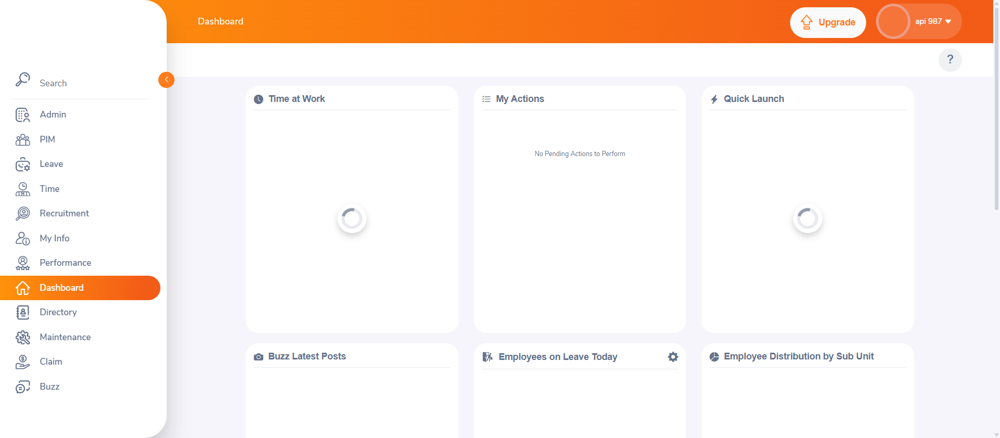
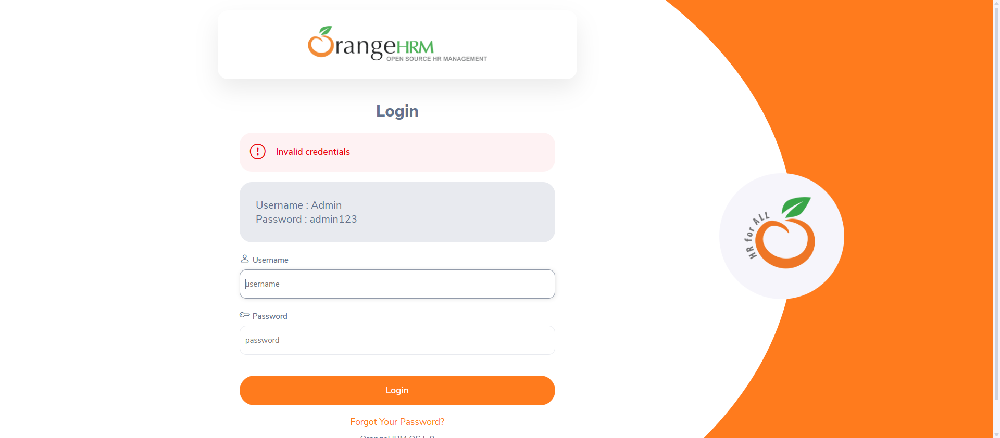
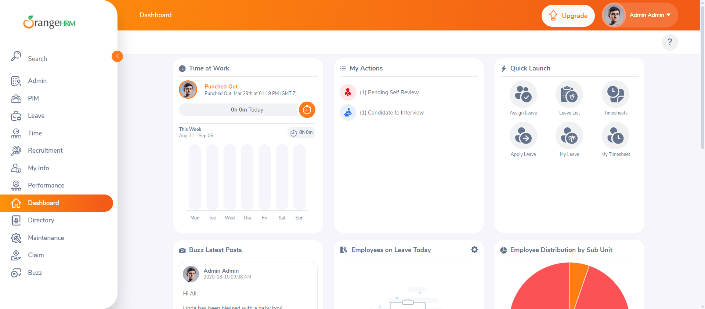
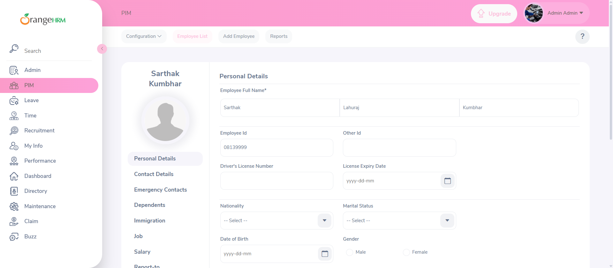
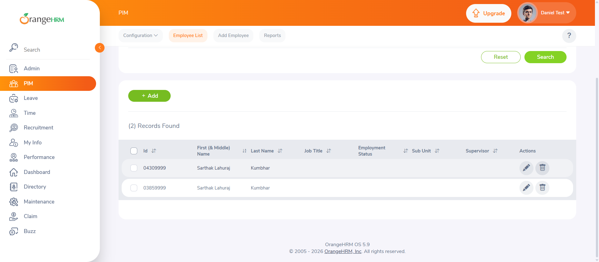
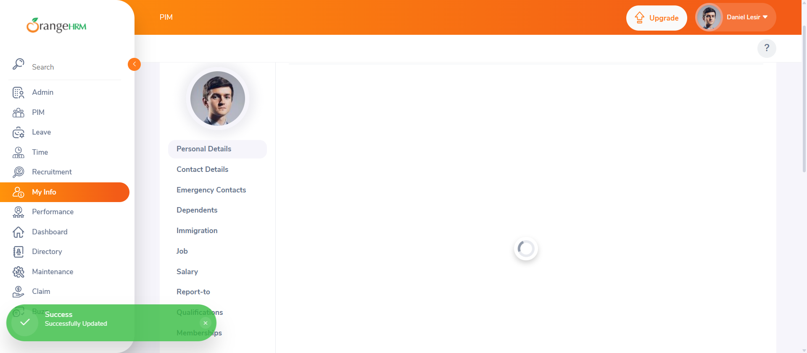
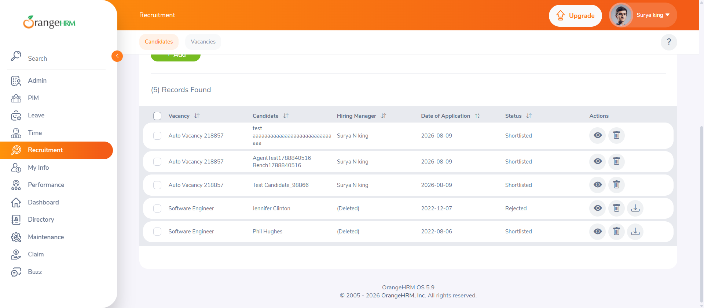
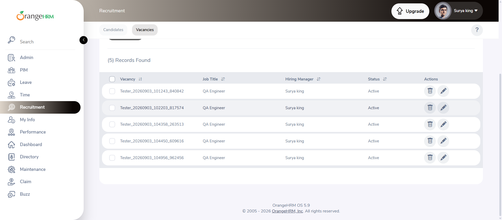
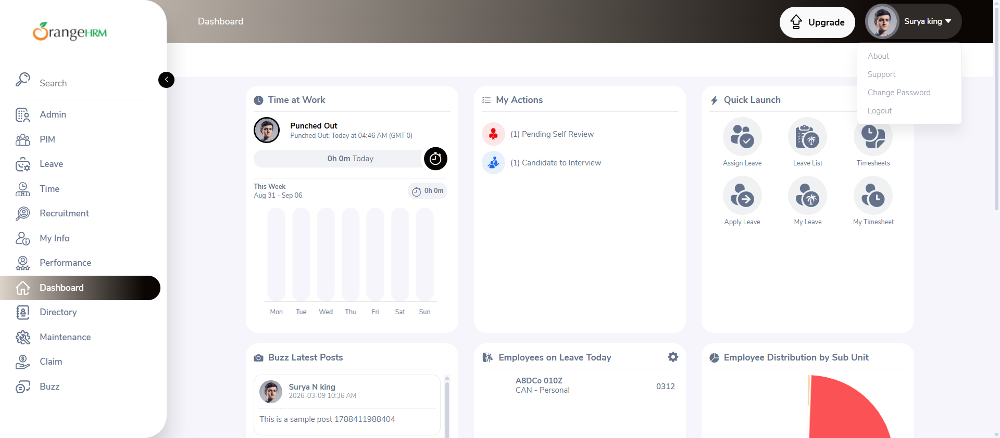
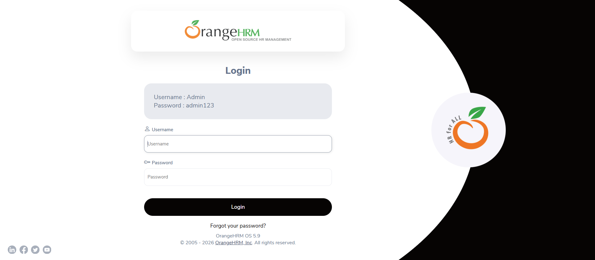

# OrangeHRM Web Application Automation Testing

**Academic Project | Software Testing (CSA603)**

Automated testing of the OrangeHRM Demo web application using **Python and Selenium WebDriver** to verify important functionalities such as login, employee management, recruitment, and logout.

## 📌 Project Overview

This project focuses on automating functional test cases for the OrangeHRM Demo web application. Selenium WebDriver is used to interact with web elements, perform user actions, verify application behavior, and capture screenshots of test results.

The project includes **9 automated test cases**, all of which passed successfully during execution.

## 🎯 Objectives

- Automate important functionalities of OrangeHRM.
- Verify application behavior using valid and invalid inputs.
- Reduce repetitive manual testing effort.
- Execute test cases consistently using Python scripts.
- Capture screenshots as evidence of test execution.
- Compare expected and actual results and record test status.

## 🛠️ Technologies Used

- **Programming Language:** Python
- **Automation Tool:** Selenium WebDriver
- **Browser:** Google Chrome
- **Code Editor:** Visual Studio Code
- **Testing Type:** Functional Testing, Web UI Automation Testing
- **Application Under Test:** OrangeHRM Demo

## 🧪 Test Cases

| Test Case ID | Test Case Description | Expected Result | Status |
|---|---|---|---|
| TC-01 | Login with Valid Credentials | User logs in successfully and Dashboard is displayed. | PASS |
| TC-02 | Login with Invalid Credentials | Login is rejected and an error message is displayed. | PASS |
| TC-03 | Verify Dashboard After Successful Login | Dashboard loads successfully with its widgets. | PASS |
| TC-04 | Add New Employee | Employee is added successfully. | PASS |
| TC-05 | Search Employee by Name | Matching employee records are displayed. | PASS |
| TC-06 | Enter Personal Details | Personal details are updated successfully. | PASS |
| TC-07 | Check Candidates | Candidates matching the Software Engineer job title are displayed. | PASS |
| TC-08 | Check Vacancies | Vacancies matching the QA Engineer job title are displayed. | PASS |
| TC-09 | Logout | User is logged out and redirected to the Login page. | PASS |

## 📊 Test Execution Summary

| Metric | Result |
|---|---:|
| Total Test Cases | 9 |
| Passed | 9 |
| Failed | 0 |
| Pass Percentage | 100% |

## ⚙️ Prerequisites

Before running the test scripts, ensure the following are installed:

- Python 3.x
- Google Chrome
- Visual Studio Code (recommended)
- Selenium WebDriver Python package

## 🚀 Installation and Setup

**1. Clone the repository**

```bash
git clone <https://github.com/SarthakKumbhar18/OrangeHRM-Selenium-Automation.git>
```

**2. Navigate to the project directory**

```bash
cd <OrangeHRM-Selenium-Automation>
```

**3. Install Selenium**

```bash
python -m pip install -U selenium
```

**4. Run a test case**

Navigate to the folder containing the required test script and execute it:

```bash
python <test_script_name>.py
```

Replace `<test_script_name>.py` with the actual Python filename.

Selenium Manager can automatically manage the required browser driver in supported environments. Ensure Google Chrome is installed and your system can access the required driver resources.

## 📁 Project Structure

```text
OrangeHRM-Automation-Testing/
│
├── TC01/
│   └── <TC01 test script>
│
├── TC02/
│   └── <TC02 test script>
│
├── TC03-Verify Dashboard/
│   └── <TC03 test script>
│
├── TC04/
│   └── <TC04 test script>
│
├── TC05/
│   └── <TC05 test script>
│
├── TC06-Enter Personal Details/
│   └── <TC06 test script>
│
├── TC07-Check Candidates/
│   └── <TC07 test script>
│
├── TC08-Check Vacancies/
│   └── <TC08 test script>
│
├── TC09-Logout/
│   └── <TC09 test script>
│
├── screenshots/
│   ├── TC01_Login_Valid.png
│   ├── TC02_Login_Invalid.png
│   ├── TC03_Dashboard.png
│   ├── TC04_Add_Employee.png
│   ├── TC05_Search_Employee.png
│   ├── TC06_Personal_Details_Updated.png
│   ├── TC07_Check_Candidates.png
│   ├── TC08_Check_Vacancies.png
│   ├── TC09_Logout_Dropdown.png
│   └── TC09_Logout_Result.png
│
└── README.md
```

*Note: Adjust the folder names, script filenames, and screenshot filenames to match the actual files uploaded to your repository.*

## 📸 Screenshots and Test Evidence

The following screenshots provide visual evidence of the automated test execution.

### TC-01: Login with Valid Credentials



### TC-02: Login with Invalid Credentials



### TC-03: Dashboard Verification



### TC-04: Add New Employee



### TC-05: Search Employee by Name



### TC-06: Enter Personal Details



### TC-07: Check Candidates



### TC-08: Check Vacancies



### TC-09: Logout

**Profile dropdown before logout**



**Login page after logout**



## ✅ Conclusion

This project demonstrates the use of Selenium WebDriver with Python to automate functional testing of a web application. Nine test cases covering authentication, dashboard verification, employee management, recruitment, and logout were executed successfully.

The project provided practical experience in browser automation, test case execution, result verification, and screenshot-based test documentation.
